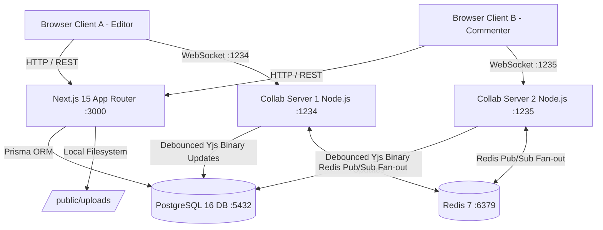

# System Architecture & Design Specification

## Overview

FS-02 is an enterprise-grade real-time collaborative workspace blending the linear document power of **Notion** and the multi-mode aesthetic of **AFFiNE** (`https://app.affine.pro`). It unites real-time collaborative document editing with structured project lifecycle tracking, Kanban task management, and file attachment storage.

---

## Architectural Layers

### 1. Presentation & Application Shell Layer (Next.js 15 App Router)
- **Framework:** Next.js 15 with React Server Components (RSC) and Client Components (`'use client'`).
- **Styling & Design Tokens:** AFFiNE modern design system in `app/globals.css` with CSS custom properties (`--affine-primary`, `--affine-sidebar-bg`, etc.) and instant light/dark mode switching (`[data-theme="dark"]`).
- **Global Command Palette:** Spotlight modal (`Ctrl+K` / `Cmd+K`) searching across documents, projects, tasks, and team members.
- **Top Header:** Breadcrumbs, Page vs Edgeless mode switcher, presence indicators, Export menu (Markdown, HTML, JSON snapshot), and comment/history slide-over drawer triggers.

### 2. Real-Time Collaboration & CRDT Transport (Node.js + Yjs + Redis)
- **CRDT Engine:** Yjs shared document (`Y.Doc`) providing conflict-free concurrent editing without operational transformation lag.
- **WebSocket Protocol:** `y-websocket` binary protocol with custom room authorization.
- **Security:** Signed JWT (`jose`) minted by `GET /api/collab-token` after validating database membership.
- **Role Enforcement at the Transport:**
  - `VIEW`: Receives document sync and awareness; incoming updates dropped.
  - `COMMENT`: Receives sync and awareness; comments submitted via authenticated REST API.
  - `EDIT`: Full read-write synchronization and cursor broadcast.
- **Multi-Instance Scaling:** Collab server instances subscribe to Redis channels (`yjs:page:{pageId}`). When an update is received on one instance, it is published to Redis and fanned out to all other connected instances, ensuring seamless cross-server synchronization.

### 3. Persistence Layer (PostgreSQL 16 via Prisma)
- **Relational Tables:** Users, Workspaces, Memberships, Pages, Comments, Snapshots, Projects, Tasks, and ProjectFiles.
- **Binary Persistence:** Document state stored as `BYTEA` using `Y.encodeStateAsUpdate(ydoc)`. Debounced to avoid disk thrashing during rapid keystrokes.
- **File Uploads:** Uploaded project files stored in `public/uploads` with database metadata tracking size, MIME type, and uploader identity.

---

## Conflict Resolution & Hybrid Alignment

| Aspect | AFFiNE Web Pattern | FS-02 Collaborative Workspace Resolution |
| :--- | :--- | :--- |
| **Document Navigation** | Collapsible full-height sidebar | 256px sidebar providing 1-click access to Docs, Projects, Tasks, and Team without page reloads. |
| **Canvas vs Document** | BlockSuite canvas | Page Mode keeps TipTap + Yjs CRDT real-time text synchronization. Edgeless Mode switches into an interactive card grid of workspace assets. |
| **Comments & History** | Right slide-over drawer | Replaced static 40% side cards with a 360px animated slide-over panel that preserves full editor canvas width. |
| **Export Formats** | Multi-format export | Built-in export to clean Markdown (`.md`), HTML (`.html`), and raw JSON snapshot (`.json`). |
